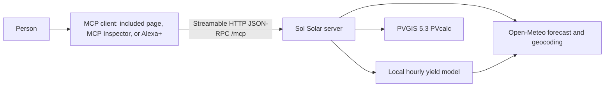

# Sol Solar

Sol Solar is a self-hosted [MCP](https://modelcontextprotocol.io) server that answers solar questions for one home array or a small solar node: how much the panels should make today and tomorrow, when to run a heavy appliance, what that energy is worth at a price you type in, and what a typical year looks like.

It was built in October 2026 during the [Amazon Developer Hackathon](https://amazonappdev2026.devpost.com/) for the Alexa+ track. The author is Vadym Bilobrovets, working solo. The repository was created for this entry. Nothing in it is a pre-existing product with a new coat of paint.

The server speaks MCP specification **2025-11-25** over **Streamable HTTP** (`POST /mcp`, JSON responses, `GET /mcp` returns 405 because there is no standalone SSE stream). Both of those response shapes are allowed by the [2025-11-25 transport spec](https://modelcontextprotocol.io/specification/2025-11-25/basic/transports). The implementation uses `@modelcontextprotocol/sdk` 1.32.1, whose `LATEST_PROTOCOL_VERSION` is `2025-11-25`.

## What you can ask

| Tool | What it answers |
| --- | --- |
| `resolve_location` | Turns a place name into coordinates (Open-Meteo geocoder / GeoNames). |
| `forecast_pv_production` | Remaining energy today and all of tomorrow, hourly, for a nameplate kW size. |
| `best_appliance_hours` | The contiguous hours when forecast production best covers a load you describe. It does not switch anything on. |
| `estimate_savings` | Multiplies kWh by a price **you** supply. It does not look up a tariff. |
| `typical_monthly_yield` | PVGIS 5.3 typical-year monthly and yearly energy. Not a forecast for this week. |

Every energy figure is an estimate. It is not a meter reading, a bill, or a promise that an appliance will be covered by the sun.

## Architecture



The short-term tools take Open-Meteo `global_tilted_irradiance` (preceding-hour mean, W/m²) and air temperature, then apply a local model:

- Cell temperature ≈ air temperature + 0.03125 × irradiance. The coefficient is the usual linear NOCT approximation with NOCT = 45°C: `(45 − 20) / 800`.
- Power falls 0.4% per °C of cell temperature above 25°C, a typical crystalline-silicon assumption, not a measurement of your modules.
- A system-loss percentage (default 14, the PVGIS default) covers inverter, cables, and soiling. Temperature is not inside that percentage.
- Hourly kWh equals estimated average kW for that hour.
- Tilt defaults to absolute latitude, clamped to 10–60°. Azimuth defaults to due south in the northern hemisphere and due north in the southern hemisphere. The convention, shared by Open-Meteo and PVGIS, is **0° = south**, −90° = east, 90° = west, ±180° = north.

`typical_monthly_yield` does not use that model. It returns PVGIS's own PVcalc result, so the two tools will not match, and they should not: one is a weather forecast and the other is climatology.

The current clock hour is counted in full, so a request made halfway through an hour slightly overstates energy still to come. Around a daylight-saving change, hour labels are wall-clock arithmetic and can be ambiguous.

## Run it locally

Requires Node.js 22 or newer.

```bash
npm ci
npm test
npm run dev
```

- MCP endpoint: `http://127.0.0.1:3000/mcp`
- Simulator (a real MCP client): `http://127.0.0.1:3000/`
- Health: `http://127.0.0.1:3000/health`

`npm test` includes live calls to Open-Meteo and PVGIS. `npm run typecheck` only checks types.

The server binds to `127.0.0.1` unless you set `HOST`. Set `HOST=0.0.0.0` in a container. Optional environment variables:

| Variable | Meaning |
| --- | --- |
| `PORT` | Default `3000`. |
| `HOST` | Default `127.0.0.1`. |
| `ALLOWED_HOSTS` | Comma-separated hostnames for DNS-rebinding protection when you bind all interfaces. |
| `ALLOWED_ORIGINS` | Extra browser `Origin` values allowed to call `/mcp`. `localhost` and `127.0.0.1` are always allowed. A missing `Origin` is allowed so curl and MCP Inspector work. Any other origin gets HTTP 403. |
| `UPSTREAM_TIMEOUT_MS` | Default `12000`. |

Refresh a captured sample (this writes `docs/samples/kyiv-5kw.json`):

```bash
npm run example
```

### Docker

```bash
docker build -t sol-solar-mcp .
docker run --rm -p 3000:3000 sol-solar-mcp
```

The container listens on `0.0.0.0:3000`. Notes for AWS Lambda and App Runner are in [docs/AWS.md](docs/AWS.md). This repository was not deployed to AWS from the hackathon build environment.

### MCP Inspector

The official inspector is a separate client. From another terminal, with the server already running:

```bash
npx @modelcontextprotocol/inspector
```

Connect it to `http://127.0.0.1:3000/mcp` using Streamable HTTP. The included page at `/` is the client used for the hackathon demo, because the Alexa+ web simulator is not available to participants (see below).

## Example calls

These responses were captured at **2026-10-17T23:39:52Z**. In Kyiv that was **2026-10-18 02:39** (`Europe/Kyiv`, UTC+3). The array is **5 kW** nameplate, tilt **35°**, azimuth **0°** (south), system loss **14%**, at the geocoder's Kyiv point **50.45466°N, 30.5238°E**. Forecast numbers change with the weather. Re-run `npm run example` rather than trusting this snapshot.

The Open-Meteo forecast for that morning was heavily clouded. Plane-of-array irradiance around solar noon was about **51 W/m²**, so the model estimates only **1.31 kWh** still to come on 18 October and **3.77 kWh** on 19 October. That is not a broken model: PVGIS puts a typical October day for this same 5 kW array near **12.78 kWh**. The gap is cloud, and the tool is supposed to show it.

### 1. Resolve Kyiv

```json
{
  "jsonrpc": "2.0",
  "id": 2,
  "method": "tools/call",
  "params": { "name": "resolve_location", "arguments": { "place": "Kyiv" } }
}
```

Spoken summary:

> The best match for "Kyiv" is Kyiv, Kyiv City, Ukraine at 50.45°, 30.52° (Europe/Kyiv).

### 2. Forecast a 5 kW array

```bash
curl -s http://127.0.0.1:3000/mcp \
  -H 'content-type: application/json' \
  -H 'accept: application/json, text/event-stream' \
  -d '{"jsonrpc":"2.0","id":3,"method":"tools/call","params":{"name":"forecast_pv_production","arguments":{"latitude":50.45466,"longitude":30.5238,"peak_power_kw":5,"tilt_degrees":35,"azimuth_degrees":0,"place_name":"Kyiv"}}}'
```

Spoken summary from the capture:

> A 5.00 kW array near Kyiv at 50.45°, 30.52° (tilt 35.0°, facing south) is estimated to produce 1.31 kWh still today (2026-10-18, Europe/Kyiv) and 3.77 kWh tomorrow. The brightest remaining hour is 13:00–14:00 at about 0.23 kWh. This is an Open-Meteo forecast through a simple model, not a meter reading.

The JSON after `SUMMARY:` includes every hour, the assumptions, and the Open-Meteo request URL. The full capture is `docs/samples/kyiv-5kw.json`. A few of that day's hours:

| Local interval | Irradiance (W/m²) | Estimated kWh |
| --- | ---: | ---: |
| 11:00–12:00 | 50.1 | 0.224 |
| 12:00–13:00 | 45.4 | 0.203 |
| 13:00–14:00 | 51.0 | 0.228 |
| 14:00–15:00 | 23.2 | 0.104 |

Tomorrow's brighter hours in the same capture peak at **172.9 W/m²** (13:00–14:00, about 0.76 kWh).

### 3. When to run a washing machine

Same array. Appliance: 2000 W for 2 hours (4.00 kWh). Captured just after the forecast above, so the weather matches.

> washing machine at 2000 W for 2.0 hours needs 4.00 kWh. The best remaining window on 2026-10-18 is 12:00–14:00, with about 0.43 kWh from the array (11% of the load). The rest would come from the grid or a battery. Estimate only, not a guaranteed schedule.

The next-best windows were 11:00–13:00 (0.427 kWh) and 10:00–12:00 (0.404 kWh).

### 4. Value energy at a price you type

The server will not invent a tariff. This call prices the captured **1.312 kWh** at a caller-supplied **1.00 UAH per kWh**. 1.00 is a placeholder so the arithmetic is obvious, not a Ukrainian retail rate.

> Valuing 1.31 kWh at 1.00 UAH per kWh (100% is assumed to offset a purchase) comes to about 1.31 UAH. You supplied the price. This is not a bill and it ignores fixed charges, taxes, and local net-metering rules.

### 5. Typical year from PVGIS

Same 5 kW array, tilt 35°, south, 14% losses. PVGIS 5.3 selected **PVGIS-SARAH3** and **ERA5**, years **2005–2023**.

> PVGIS 5.3 estimates about 5570 kWh per year (15.26 kWh per day on average) for this 5.00 kW array, using PVGIS-SARAH3 and ERA5 for 2005–2023. The highest typical month is July at 707 kWh, and the lowest is December at 139 kWh. This is a long-term climate figure, not a forecast for this year.

October in that typical year is **396.31 kWh** (12.78 kWh/day). The yearly standard deviation reported by PVGIS was **241.58 kWh**. Exact fields are in `docs/samples/kyiv-5kw.json`.

## Connect to Alexa+

Amazon's [MCP QuickStart](https://developer.amazon.com/docs/alexaplus/add-ons/mcp-toolkit-quickstart.html) is the document this section follows. A production add-on needs all of the following:

1. Streamable HTTP, not the legacy standalone SSE transport. Spec 2025-11-25 or later.
2. A public HTTPS URL. A tunnel such as cloudflared is what Amazon suggests for local development.
3. OAuth 2.1 authorization-code flow with PKCE (`S256`). Unauthenticated MCP requests must return **401 without a `WWW-Authenticate` header**. Protected Resource Metadata (RFC 9728) and `/.well-known/oauth-authorization-server` must be published, and `code_challenge_methods_supported` must include `S256`.
4. The token request carries `resource` and `code_verifier`. The access token goes in the `Authorization` header, never the query string.
5. Dynamic client registration, client ID metadata documents, OpenID Connect, and step-up auth are listed as not supported yet.
6. Round-trip latency under **500 ms**.
7. Onboarding with the Alexa AI CLI (`alexa-ai configure`, then `alexa-ai new mcp` or the add-on agent skill, then `alexa-ai deploy`). That path needs an Alexa developer account and the add-on tools.

**This entry does not complete that account link.** The hackathon FAQ states that the Alexa+ Category SDK, MCP Toolkit, CLI, and web simulator are in preview for select partners, and that participants cannot apply for access. The accepted demo is your own MCP client that sends `initialize`, `tools/list`, and `tools/call` over Streamable HTTP. That client is the page served at `/`.

Two further gaps are deliberate and documented rather than faked:

- There is no OAuth resource server. Local clients would all get 401, and there is no partner console to complete linking against. Adding a pretend login would not be a real Alexa+ connection.
- Latency is not guaranteed. A live forecast from this environment returned in about 400 ms, but PVGIS is often slower, and a Lambda cold start would miss 500 ms. Responses are cached in memory for 10 minutes (forecasts) or 24 hours (geocoding and PVGIS) so a repeat question can be fast. The first question still waits on the upstream API.

Text-only tools are what Amazon's quickstart tells you to ship when you are not building MCP Apps visuals. These tools are text.

## Data sources and licences

| Source | Used for | Licence |
| --- | --- | --- |
| [Open-Meteo forecast API](https://open-meteo.com/en/docs) | Hourly `global_tilted_irradiance` and `temperature_2m` | API data under [CC BY 4.0](https://creativecommons.org/licenses/by/4.0/). Attribution and the licence link are required. See [Open-Meteo's licence page](https://open-meteo.com/en/license). Upstream models include ECMWF and other national services listed there; several of those are also CC BY. |
| [Open-Meteo geocoding](https://open-meteo.com/en/docs/geocoding-api) | Place names | Same CC BY 4.0 offer. The location database is GeoNames (CC BY), as listed by Open-Meteo. |
| [PVGIS 5.3 PVcalc](https://joint-research-centre.ec.europa.eu/photovoltaic-geographical-information-system-pvgis/getting-started-pvgis/api-non-interactive-service_en) | Typical-year monthly and yearly yield | [JRC says PVGIS information is free and there are no restrictions on its use](https://joint-research-centre.ec.europa.eu/photovoltaic-geographical-information-system-pvgis/general-information/usage-conditions-data-protection_en). |

No API key is required for either source. Open-Meteo's own server code is AGPL-3.0; this project does not copy that code, it only calls the HTTP API. The docs page also shows a non-commercial / commercial / self-hosted switch for the hosted API, so read Open-Meteo's current terms before using the hosted endpoint in a commercial product. This hackathon demo uses the public endpoint and attributes it.

Weather data by [Open-Meteo.com](https://open-meteo.com/). PVGIS © European Union, Joint Research Centre. PVGIS output is not an official Commission forecast for a particular day.

The code in this repository is [MIT](LICENSE), copyright 2026 Solar-DePIN-Hub.

## Tests

```bash
npm test
```

- `tests/model.test.ts` checks the yield math, window ranking, and price arithmetic with no network.
- `tests/http.test.ts` starts the server, checks protocol `2025-11-25`, rejects a non-local `Origin`, and drives all five tools through the official `StreamableHTTPClientTransport` with stubbed upstream responses.
- `tests/live.test.ts` geocodes Kyiv, asks PVGIS for a 5 kW typical year, and performs one live `tools/call` for the forecast.

## Hackathon notes

- Primary track: Alexa+.
- Submission draft, demo script, and AWS deploy notes: `docs/SUBMISSION.md`, `docs/DEMO_SCRIPT.md`, `docs/AWS.md`.
- The project was built during the hackathon window (31 August 2026 – 23 October 2026). Deadline used here: 23 October 2026, 12:00 Pacific, which is 22:00 in Kyiv.
