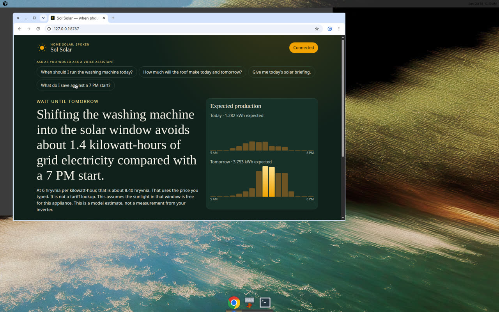
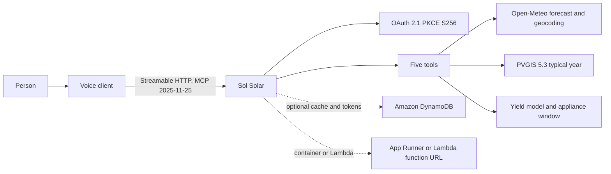

# Sol Solar

Ask a voice assistant when to run the washing machine. Sol Solar is a self-hosted [MCP](https://modelcontextprotocol.io) server that answers with a sentence, using a live solar forecast and a typical-year comparison. It was built in October 2026 for the [Amazon Developer Hackathon 2026](https://amazonappdev2026.devpost.com/), Alexa+ track.

On 18 October 2026, for a 5 kW array in Kyiv tilted 35 degrees and facing south, the server answered a two-hour wash assumed at 0.7 kW like this:

> Wait until tomorrow. Run the washing machine from 1 PM to 3 PM. That washing machine, running for 2 hours at 0.7 kilowatts, is about 1.4 kilowatt-hours. The roof should cover it in that window. Today the array is expected to make about 1.3 kilowatt-hours, so waiting is the better solar plan. A typical October day for this array is about 12.8 kilowatt-hours in the PVGIS record, so the forecast days are dim. This is a model estimate, not a measurement from your inverter.

The 0.7 kW and 2 hours are inputs, not a measurement of a machine. The 6 UAH price used in the savings example below was typed for the demo. It is not a tariff lookup. Forecasts change. Run `npm run demo` for the current day.

The browser client, after OAuth PKCE, on that same day:



Author: Vadym Bilobrovets, solo, Ukraine. The repository was created on 17 October 2026. This server was written during the hackathon submission window.

## Quick start

```bash
npm install
npm run dev
```

Open http://127.0.0.1:8787/ and ask "When should I run the washing machine today?"

In another terminal, the same question over the official MCP client:

```bash
npm run demo
npm run demo -- --price 6 --currency UAH
```

`npm test` runs the suite without the network. `npm run test:live` calls Open-Meteo and PVGIS for Kyiv.

## Architecture



The browser page is a real MCP client. It sends `initialize`, `notifications/initialized`, and `tools/call` to `POST /mcp`. It speaks the tool's text. It does not call a language model, so the kilowatt-hours cannot be invented by one.

The server imports and uses `@modelcontextprotocol/sdk` (`McpServer`, `StreamableHTTPServerTransport`, and, in `src/demo.ts` and the tests, `Client` with `StreamableHTTPClientTransport`). The negotiated protocol version in this SDK release is `2025-11-25`.

## Tools

| Tool | What you ask | What it does |
| --- | --- | --- |
| `remember_solar_site` | "My array is 5 kilowatts in Kyiv." | Resolves the place, remembers size, tilt, azimuth, and an optional price you typed. |
| `forecast_pv_production` | "How much solar should I expect today and tomorrow?" | Hourly forecast, plus a PVGIS typical day for this month. |
| `best_time_for_appliance` | "When should I run the washing machine?" | Finds the best future window. Usable solar in an hour is capped at the appliance's power. |
| `estimate_savings` | "What do I save against 7 PM?" | Grid kilowatt-hours avoided. Money only if you typed a price. |
| `daily_solar_briefing` | "How does the roof look today?" | One spoken briefing, with the appliance included when you pass one. |

A prompt, `answer_solar_question`, tells a client to say the tool text and not invent numbers.

Follow-up calls in the same MCP session can omit the place. The tool also returns `site_id` for clients that do not keep a session. Memory is in the server process unless `TOKEN_STORE=dynamodb`. A restart clears it.

## Example output

Captured with `npm run demo -- --price 6 --currency UAH` while Kyiv's local date was 18 October 2026. Protocol reported by the client: `2025-11-25`.

`remember_solar_site` (481 ms):

> I'll remember a 5 kilowatt array in Kyiv, Ukraine, tilted 35 degrees and facing south. Ask when to run an appliance, or ask what the roof should make today.

`best_time_for_appliance` (869 ms, cold, Open-Meteo and PVGIS together):

> Wait until tomorrow. Run the washing machine from 1 PM to 3 PM. That washing machine, running for 2 hours at 0.7 kilowatts, is about 1.4 kilowatt-hours. The roof should cover it in that window. Today the array is expected to make about 1.3 kilowatt-hours, so waiting is the better solar plan. A typical October day for this array is about 12.8 kilowatt-hours in the PVGIS record, so the forecast days are dim. This assumes the sunlight in that window is free for this appliance. This is a model estimate, not a measurement from your inverter.

`forecast_pv_production` (35 ms after that cache fill):

> Today in Kyiv, Ukraine, the 5 kilowatt array is expected to make about 1.3 kilowatt-hours. Tomorrow it is expected to make about 3.8 kilowatt-hours. That is well below a typical October day of about 12.8 kilowatt-hours (PVGIS-SARAH3 from 2005 to 2023). This is a model estimate, not a measurement from your inverter.

`estimate_savings`, with the typed example price of 6 UAH per kilowatt-hour:

> Shifting the washing machine into the solar window avoids about 1.4 kilowatt-hours of grid electricity compared with a 7 PM start. At 6 hryvnia per kilowatt-hour, that is about 8.40 hryvnia. That uses the price you typed. It is not a tariff lookup. This assumes the sunlight in that window is free for this appliance. This is a model estimate, not a measurement from your inverter.

Alexa+ asks for a round trip under 500 ms. The cold call above took 869 ms. The cached forecast took 35 ms. See the friction log in [docs/SUBMISSION.md](docs/SUBMISSION.md).

## How the estimate is made

Open-Meteo `global_tilted_irradiance` is the preceding-hour mean on the tilted plane (albedo 0.2, isotropic sky). The timestamp is the end of that hour. Azimuth follows Open-Meteo and PVGIS: 0 is south, -90 is east, 90 is west, 180 is north.

For each hour:

```text
cell temperature ≈ air temperature + (GTI / 800) × 25
temperature factor = 1 - 0.004 × (cell temperature - 25)
kilowatt-hours = (GTI / 1000) × system kilowatts × temperature factor × 0.86
```

The 25°C rise at 800 W/m² is a stand-in for NOCT. The 14% system loss matches PVGIS's default `loss` parameter. The temperature factor is clamped to 0.5–1.15. Wind is ignored on this path. PVGIS models temperature and wind itself, so the typical-year number is not the same formula as the forecast. The spoken answer says which source each number came from.

An appliance can only use as much power as it draws. A 0.7 kW wash does not absorb a 3 kW solar hour. If today can cover at least 95% of the load, the server keeps today even when tomorrow is sunnier. Otherwise it takes the window with more usable solar.

If the weather service fails and PVGIS still answers, the server says so and gives the typical day instead of inventing today's number. If a place name matches several towns of similar size, it lists them and does not guess. "Kyiv" resolves to Kyiv, Ukraine, because that match is the capital and much larger than the others.

## Connect to Alexa+

Amazon's checklist for a self-hosted MCP server is published in the [Alexa+ MCP QuickStart](https://developer.amazon.com/docs/alexaplus/add-ons/mcp-toolkit-quickstart.html):

- Streamable HTTP, MCP specification 2025-11-25 or later. This server negotiates `2025-11-25`. The deprecated SSE-only transport is not mounted.
- A public HTTPS URL. Locally, a tunnel such as `cloudflared` can expose `http://127.0.0.1:8787/mcp`.
- `401` for a missing bearer token, without a `WWW-Authenticate` header.
- Protected Resource Metadata at `/.well-known/oauth-protected-resource` and `/.well-known/oauth-protected-resource/mcp` ([RFC 9728](https://www.rfc-editor.org/rfc/rfc9728)).
- Authorization server metadata at `/.well-known/oauth-authorization-server`, with `code_challenge_methods_supported` including `S256`.
- OAuth 2.1 authorization code plus PKCE S256. The token request must include `resource` (this server's MCP URL) and `code_verifier`. The bearer token goes in the `Authorization` header, never the query string.
- Dynamic client registration, CIMD, and OIDC are not implemented, because the QuickStart says Alexa+ does not support them yet. Register Amazon's client id with `OAUTH_CLIENT_IDS` and its redirect URI with `OAUTH_REDIRECT_URIS` when you have them.

The QuickStart then uses `alexa-ai configure` and `alexa-ai new mcp`. The hackathon FAQ says participants cannot access that CLI, the MCP toolkit, or Amazon's web simulator, and that there is no application path. This project therefore includes its own voice client at `/`, which sends the real MCP messages. MCP Inspector also works:

```bash
npm run token
npx @modelcontextprotocol/inspector
```

Connect the inspector to `http://127.0.0.1:8787/mcp` and send `Authorization: Bearer` plus the printed token. The dev token is optional and off unless `DEV_BEARER_TOKEN` is set to at least 16 characters.

Text is the customer experience. There is no audio or video stream to transcode.

## Data sources and licences

| Source | Used for | Licence and terms |
| --- | --- | --- |
| [Open-Meteo forecast](https://open-meteo.com/en/docs) | Hourly tilted irradiance and air temperature | [API data under CC BY 4.0](https://open-meteo.com/en/license). Attribute with a link: Weather data by Open-Meteo.com. The [terms](https://open-meteo.com/en/terms) limit the free API to non-commercial use, under 10,000 calls a day, 5,000 an hour, and 600 a minute. Personal home automation is one of their non-commercial examples. A commercial product needs their paid subscription. |
| [Open-Meteo geocoding](https://open-meteo.com/en/docs/geocoding-api) | Place names | Same API terms. Their licence page credits the location database to GeoNames, CC BY. |
| [PVGIS 5.3 `PVcalc`](https://joint-research-centre.ec.europa.eu/photovoltaic-geographical-information-system-pvgis/using-pvgis-5/api-non-interactive-service_en) | Typical-year daily and monthly yield, and a suggested tilt when you do not pass one | [JRC geospatial data page](https://joint-research-centre.ec.europa.eu/photovoltaic-geographical-information-system-pvgis/general-information/geospatial-data-download_en): free for public use when the source is acknowledged. Acknowledgement used here: PVGIS © European Communities, 2001-2026. The API response names the radiation database and the year range. PVGIS does not allow browser AJAX, so only this server calls it. |

This repository is MIT. See `LICENSE`. That licence does not replace the data licences above.

## Run and deploy

Local bind is `127.0.0.1:8787`. Set `HOST=0.0.0.0` inside a container. Set `PUBLIC_BASE_URL` to the HTTPS origin clients will use, with no trailing slash. The OAuth `resource` is `${PUBLIC_BASE_URL}/mcp`.

```bash
docker build -t sol-solar-mcp .
docker run --rm -p 8787:8787 sol-solar-mcp
```

AWS Lambda, a function URL, and DynamoDB are described in [docs/AWS.md](docs/AWS.md). The template is `infra/template.yaml`. It was not deployed from this environment. The hackathon's AWS credit request form closed on 7 October 2026, and no AWS account was configured here.

| Variable | Default | Role |
| --- | --- | --- |
| `PORT` | `8787` | HTTP port |
| `HOST` | `127.0.0.1` | Bind address |
| `PUBLIC_BASE_URL` | `http://127.0.0.1:$PORT` | OAuth issuer and MCP resource origin |
| `OAUTH_CLIENT_IDS` | `sol-solar-web` is always allowed | Extra pre-registered clients, comma-separated |
| `OAUTH_REDIRECT_URIS` | local demo URLs outside production | Extra exact redirect URIs |
| `DEV_BEARER_TOKEN` | unset | Optional static bearer for local curl |
| `TOKEN_STORE` | `memory` | `dynamodb` switches the cache and tokens |
| `DYNAMODB_TABLE` | unset | Required with DynamoDB |
| `AWS_REGION` | `eu-central-1` | Region for the DynamoDB client |
| `FORECAST_TTL_SECONDS` | `1800` | Forecast cache |
| `CLIMATOLOGY_TTL_SECONDS` | `604800` | PVGIS cache |
| `SYSTEM_LOSS_FRACTION` | `0.14` | System loss in the forecast model |
| `TEMP_COEFF_PER_C` | `-0.004` | Power temperature coefficient |
| `FETCH_TIMEOUT_MS` | `8000` | Upstream timeout |
| `ALLOWED_ORIGINS` | the public origin | Extra browser origins. Non-production also allows localhost |

In production, a request to `/mcp` with an `Origin` outside the allow-list is `403`. A missing `Origin` is allowed, because non-browser MCP clients do not send one.

## Tests

```bash
npm test
npm run typecheck
npm run test:live
```

The suite covers the yield model, the window picker (including the recorded dim-day shape used as a fixture), speech that omits money when no price was typed, PKCE S256 against the RFC 7636 test vector, the DynamoDB item shape with a fake client, and a Streamable HTTP session: `401` without `WWW-Authenticate`, metadata that lists `S256`, a rejected query-string token, a rejected foreign `Origin`, tool listing, a spoken wash answer, and a follow-up that remembers the site.

## Track

Primary track: Alexa+. Mini-challenges: Open Source (this new MIT repository) and AWS Builder (Lambda and DynamoDB in the code and the SAM template; not deployed from here). Submission text, the friction log, and tool feedback are in [docs/SUBMISSION.md](docs/SUBMISSION.md). The demo script is [docs/DEMO_SCRIPT.md](docs/DEMO_SCRIPT.md).

## What this is not

It does not read an inverter, a utility account, or a Solana wallet. It does not know the author's solar plant. Prices and appliance power exist only when you type them. The sentence is an estimate for planning a load, not a promise of production or savings.
